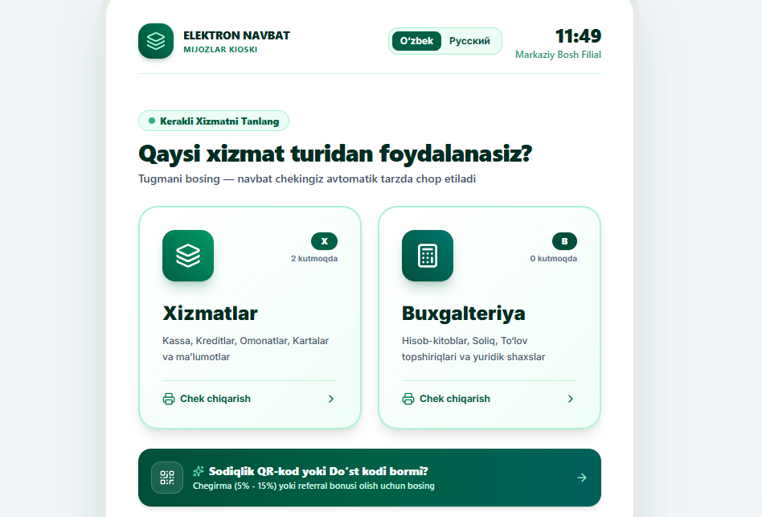
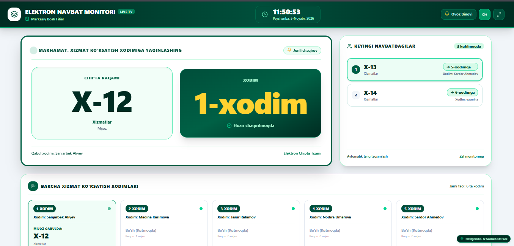
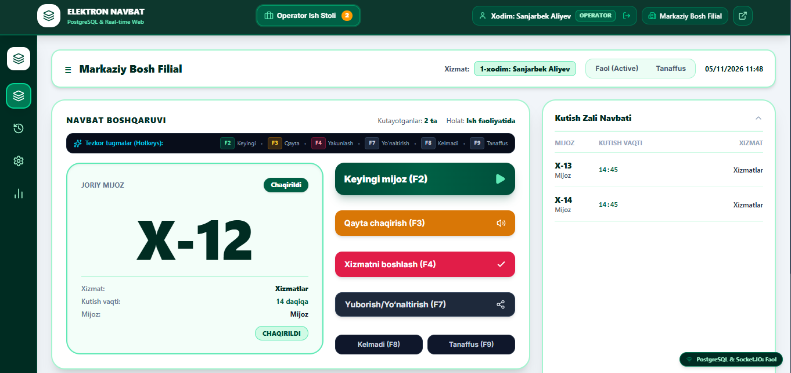
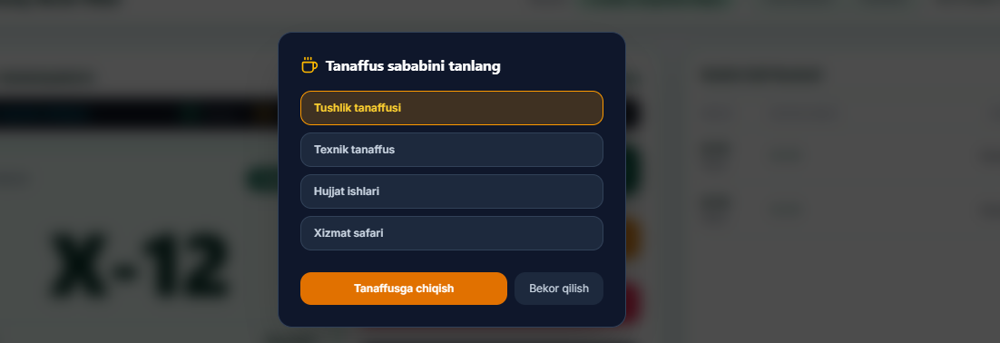
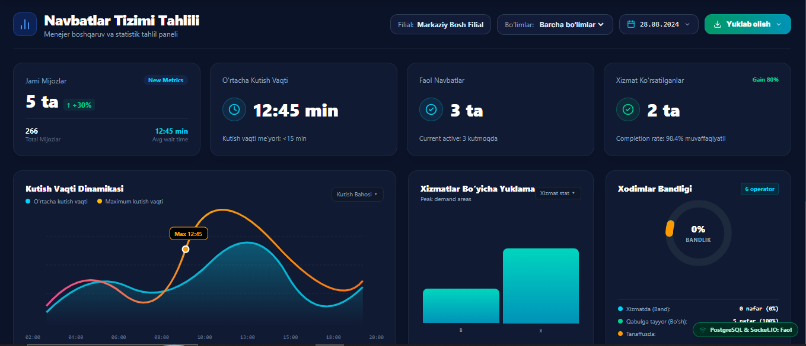
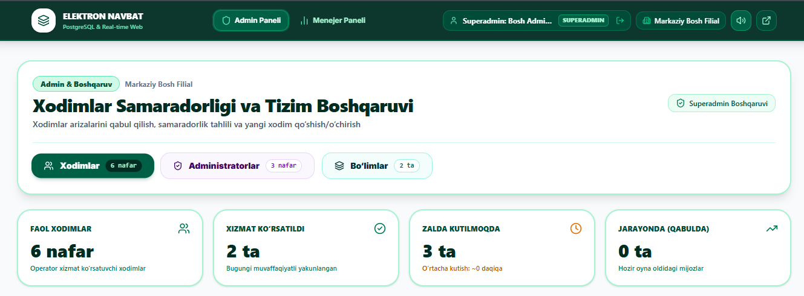
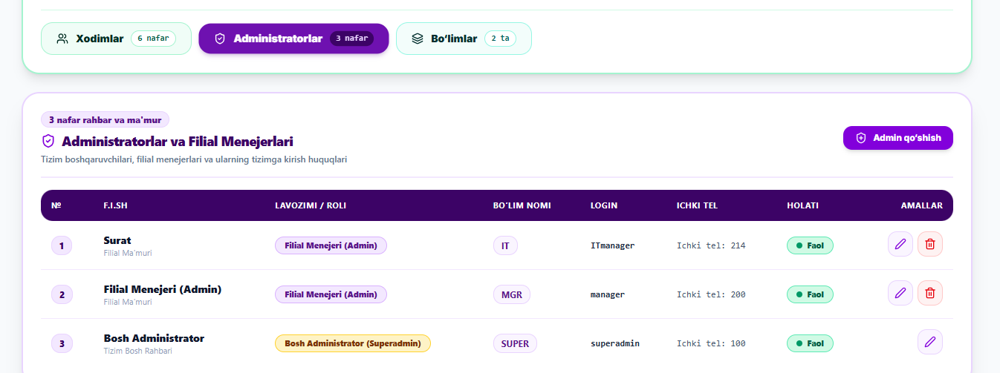
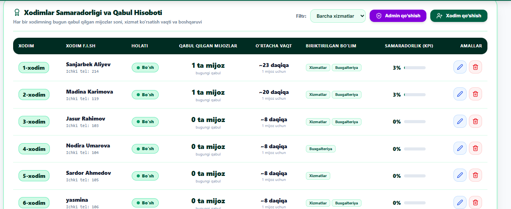
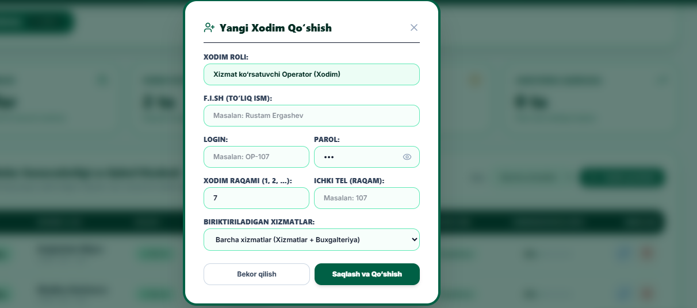
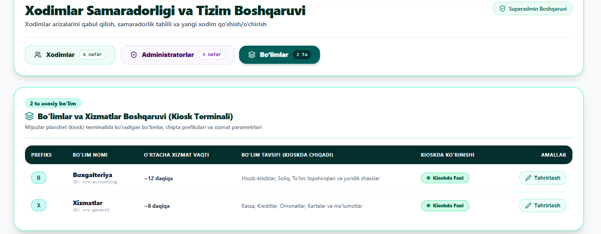

# 🏦 Elektron Navbat Boshqaruv Tizimi (QMS — Queue Management System)

[](https://react.dev/)
[](https://vitejs.dev/)
[](https://nodejs.org/)
[](https://www.postgresql.org/)
[](https://socket.io/)
[](https://tailwindcss.com/)
[](https://github.com/)

---

## 📌 Mundarija
1. [Loyiha Maqsadi](#1-loyiha-maqsadi)
2. [Tizim Qanday Ishlaydi? (Ishlash Prinsiplari)](#2-tizim-qanday-ishlaydi-ishlash-prinsiplari)
3. [Ulanishlar va Arxitektura Integratsiyasi](#3-ulanishlar-va-arxitektura-integratsiyasi)
4. [Tizim Imkoniyatlari va Afzalliklari](#4-tizim-imkoniyatlari-va-afzalliklari)
5. [Tizim Interfeyslari va Skrinshotlar (`image/`)](#5-tizim-interfeyslari-va-skrinshotlar)
6. [GitHub dan Yuklab Olib Ishlatish (O‘rnatish Qo‘llanmasi)](#6-github-dan-yuklab-olib-ishlatish-ornatish-qollanmasi)
7. [Standart Foydalanuvchilar (Login & Parollar)](#7-standart-foydalanuvchilar-login--parollar)
8. [Avtomatlashtirilgan Majburiy Testlar (13/13 Green)](#8-avtomatlashtirilgan-majburiy-testlar-1313-green)
9. [Loyiha Papkalar Tuzilmasi](#9-loyiha-papkalar-tuzilmasi)

---

## 1. Loyiha Maqsadi

Zamonaviy banklar, moliya muassasalari, davlat xizmatlari markazlari va yirik filiallarda mijozlar navbatini tartibga solish eng muhim operatsion vazifalardan biridir. 

**Ushbu loyihaning asosiy maqsadi:**
* **Tartibsizlik va sun’iy tirbandlikni yo‘qotish:** Mijozlar zalda to‘planib qolishining oldini oladi, har bir murojaatga individual raqamli chipta beriladi.
* **Adolatli va teng taqsimot (FIFO & Fair Load Balancing):** Operatorlar o‘rtasida xolis raqobatni ta’minlab, navbatlarni eng kam xizmat ko‘rsatgan bo‘sh xodimlarga adolatli yo‘naltiradi.
* **Mijozlar shaxsiy daxlsizligi (Zero-Data-Privacy):** Kiosk terminalida mijozdan pasport, ism yoki telefon raqami talab qilinmaydi. Tizim to‘liq anonim va xavfsiz ishlaydi.
* **Anonim sodiqlik dasturi (Loyalty & Referral):** Har bir chiptada anonim mijoz kodi va do‘stlar uchun taklif kodi aks etadi, tizimga qayta kelganda avtomatik chegirma va bonuslar beriladi.
* **To‘liq Real-Time va Ovozli Sinxronizatsiya:** WebSocket (Socket.IO) orqali barcha interfeyslar (Kiosk, Tablo, Xodim, Menejer, Admin) millisekundlarda sinxronlashadi hamda zalga yoqimli "ding-dong" musiqasi yangraydi.
* **Chuqur Analitika va Eksport:** Barcha ma’lumotlar PostgreSQL bazasida xronologik saqlanib, Power BI, Tableau, Excel yoki Google Sheets kabi tahliliy dasturlarga **Excel (.xlsx)** va **CSV (.csv)** formatlarida eksport qilinadi.

---

## 2. Tizim Qanday Ishlaydi? (Ishlash Prinsiplari)

Tizim quyidagi aniq mantiqiy ketma-ketlik asosida ishlaydi:

```
                  ┌───────────────────────────────────────────────┐
                  │ 1. Mijoz Kioski (Planshet Sensor Ekran)       │
                  │    Bo‘lim tanlanadi: "Xizmatlar" yoki         │
                  │    "Buxgalteriya" (1-bosishda tayyor)         │
                  └───────────────────────┬───────────────────────┘
                                          │
                                          ▼
                  ┌───────────────────────────────────────────────┐
                  │ 2. PostgreSQL Tranzaksiyasi:                  │
                  │    daily_sequences atomar hisoblagichi        │
                  │    orqali takrorlanmas raqam olinadi:         │
                  │    "X-1", "X-2", "B-1", "B-2"                 │
                  └───────────────────────┬───────────────────────┘
                                          │
                                          ▼
                  ┌───────────────────────────────────────────────┐
                  │ 3. WebSocket (Socket.IO) Broadcast:           │
                  │    - Kioskda 80mm termal chek chiqadi         │
                  │    - Katta Tabloda kutish ro‘yxatiga qo‘shiladi│
                  │    - Operatorlar oynasida navbat ko‘rinadi    │
                  └───────────────────────┬───────────────────────┘
                                          │
                                          ▼
                  ┌───────────────────────────────────────────────┐
                  │ 4. Operator Chaqiruvi (Klaviaturada F2):       │
                  │    PostgreSQL "FOR UPDATE SKIP LOCKED" orqali │
                  │    navbat faqat 1 ta bo‘sh xodimga beriladi.  │
                  └───────────────────────┬───────────────────────┘
                                          │
                                          ▼
                  ┌───────────────────────────────────────────────┐
                  │ 5. Zal Tablosi va Ovozli Signal:              │
                  │    - Yoqimli 2 tonli "Ding-Dong" musiqasi     │
                  │    - Ekranda chaqiruv yonadi:                 │
                  │      "X-1" navbati -> "1-xodim"ga (1-oyna)    │
                  └───────────────────────┬───────────────────────┘
                                          │
                                          ▼
                  ┌───────────────────────────────────────────────┐
                  │ 6. Xizmatni Yakunlash / Yo‘naltirish (F4/F7): │
                  │    Vaqtlar (kutish vaqti, xizmat davomiyligi) │
                  │    sekundigacha bazaga qayd qilinadi.         │
                  │    Operator yana AVAILABLE holatiga o‘tadi.   │
                  └───────────────────────────────────────────────┘
```

### Tig‘iz vaqtlarda (Peak Hours & Concurrency) xavfsizlik:
1. **Parallel bosishlarda takrorlanmaslik:** 10 nafar mijoz bir soniyada chipta olsa ham, `daily_sequences` jadvali orqali raqamlar hech qachon to‘qnashmaydi.
2. **Bir navbat ikki kishiga berilmasligi:** Operatorlar bir vaqtda `F2` tugmasini bossa, `SELECT ... FOR UPDATE SKIP LOCKED` tranzaksiyasi orqali navbat faqat bitta operatorga beriladi, ikkinchi operator navbatdagi keyingi mijozni oladi.
3. **Failover Requeue (Uzilib qolishdan himoya):** Agar operator navbatni chaqirib, to‘satdan internet uzilsa yoki tanaffusga chiqib ketsa, mijoz yo‘qolib ketmaydi — tizim uni avtomatik kutish ro‘yxatining boshiga qaytaradi.

---

## 3. Ulanishlar va Arxitektura Integratsiyasi

Loyiha mikroxizmatga yaqin, mustahkam modulli arxitekturada qurilgan:

```
┌─────────────────────────────────────────────────────────────────────────────┐
│                            FRONTEND (React 19 + Vite 8)                     │
│  ┌──────────────┐  ┌──────────────┐  ┌──────────────┐  ┌─────────────────┐  │
│  │ KioskView    │  │ DisplayView  │  │ StaffView    │  │ ManagerDashboard│  │
│  │ (Planshet)   │  │ (Zal TV)     │  │ (Operator)   │  │ & AdminDashboard│  │
│  └──────┬───────┘  └──────┬───────┘  └──────┬───────┘  └────────┬────────┘  │
└─────────┼─────────────────┼─────────────────┼───────────────────┼───────────┘
          │ HTTP REST       │ WebSocket Event │ Real-time State   │ Excel/CSV 
          ▼                 ▼                 ▼                   ▼
┌─────────────────────────────────────────────────────────────────────────────┐
│                         BACKEND (Node.js + Express API)                     │
│  - JWT Authentication & Strict RBAC                                         │
│  - Socket.IO Real-Time Gateway (port 5000)                                  │
│  - ExcelJS & CSV Export Engine (UTF-8 BOM)                                  │
│  - Audio Notification Engine                                                │
└──────────────────────────────────────┬──────────────────────────────────────┘
                                       │ Connection Pool (node-postgres)
                                       ▼
┌─────────────────────────────────────────────────────────────────────────────┐
│                        POSTGRESQL MA’LUMOTLAR BAZASI                        │
│  queues, daily_sequences, employees, services, branches, audit_logs         │
└─────────────────────────────────────────────────────────────────────────────┘
```

* **Frontend <-> Backend REST API:** `http://localhost:5000/api` orqali chipta yaratish, chaqirish, xodim arizalari, tahrirlash va hisobotlar yuklash.
* **Real-Time WebSocket Ulanishi:** `http://localhost:5000` orqali ikki tomonlama hodisalar (`ticket:created`, `ticket:called`, `ticket:completed`, `staff:status_changed`, `service:updated`).
* **PostgreSQL Ulanishi:** `pg.Pool` orqali 5432-portda doimiy tranzaksion ulanish.
* **Kiosk Terminali:** 100% sensor ekranlarga moslashtirilgan toza interfeys.
* **Katta Tablo Monitori (TV):** Smart TV yoki HDMI orqali ulangan kompyuterlarda to‘liq ekranda (F11) ishlaydi.
* **Tashqi Tahlil Dasturlari Integratsiyasi:** Power BI, Tableau, Excel, Python Pandas, Google Sheets uchun to‘g‘ridan-to‘g‘ri `.xlsx` va `.csv` yuklash.

---

## 4. Tizim Imkoniyatlari va Afzalliklari

* 🎯 **1 Bosishda Navbat Olish:** Mijoz faqat xizmatni tanlaydi, qog‘oz chipta termal formatda darhol chop etiladi.
* 🎁 **Anonim Sodiqlik & Referral (QR Kod):** Chiptadagi QR kod orqali navbatdagi tashriflarda 5%, 10%, 15% gacha avtomatik chegirmalar beriladi.
* ⌨️ **Tezkor Tugmalar (Hotkeys):** Operator klaviaturasidagi `F2` (Keyingi mijoz), `F3` (Qayta chaqirish), `F4` (Yakunlash), `F7` (Boshqa xizmatga yo‘naltirish), `F8` (Kelmadi), `F9` (Tanaffus).
* 🎵 **Yoqimli "Ding-Dong" Signali:** Web Audio API asosida yaratilgan harmonik ohang.
* 🛡️ **Superadmin Boshqaruv Markazi:**
  * **Xodimlar:** Xodim qo‘shish, o‘chirish, login/parol tahrirlash ("ko‘zcha" bilan parolni ko‘rish).
  * **Administratorlar:** Filial menejerlarini alohida oynada boshqarish.
  * **Bo‘limlar (Kiosk Parametrlari):** Kioskda chiqadigan xizmatlar nomi, chipta prefiksi (`X`, `B`) va tavsifini tahrirlash (kioskda darhol yangilanadi).
* 📊 **Menejer Tahliliy Paneli:**
  * Kunlik, haftalik va oylik dinamika grafigi.
  * Bo‘limlar bo‘yicha filtr: *Barcha bo‘limlar*, *Xizmatlar*, *Buxgalteriya*.
  * **Analitikani yuklab olish:** Excel, CSV va PDF formatlarida to‘liq hisobotlarni 1 ta tugma orqali yuklab olish.
* 🔒 **Rollar Bo‘yicha Qat’iy Cheklov (RBAC):**
  * `OPERATOR` faqat o‘zining ish stolini ko‘radi.
  * `MANAGER` filial statistikasi va xodimlar monitoringini ko‘radi.
  * `SUPERADMIN` butun tizim va xizmat parametrlarini to‘liq boshqaradi.

---

## 5. Tizim Interfeyslari va Skrinshotlar

Loyihaning barcha asosiy oynalari `image/` papkasida jamlangan bo‘lib, quyidagi qismlardan iborat:

### 1. Mijozlar Kiosk Terminali (`image/kiosk_monitor.png`)
Mijoz filialga kirganda planshet sensor ekranida xizmat turini tanlaydi:


---

### 2. Katta Zal Tablosi — TV Monitori (`image/monitor.png`)
Filial zalidagi televizorda joriy chaqirilgan mijozlar, kutish navbatlari va xizmat ko‘rsatuvchi xodimlar real vaqtda ko‘rsatiladi:


---

### 3. Operator Ish Stoli (`image/operator_panel.png`)
Xodim mijozni chaqirishi, xizmat ko‘rsatishi va navbatlarni boshqarishi uchun qulay ishchi panel:


---

### 4. Operator Tanaffus Rejimi (`image/operator_tanaffus.png`)
Xodim tushlik yoki tanaffusga chiqqanda tizimda uning holati "Tanaffus"ga o‘tadi va yangi navbat berilmaydi:


---

### 5. Menejer Boshqaruv va Tahlil Paneli (`image/manager_panel.png`)
Navbatlar dinamikasi, bandlik grafigi, bo‘limlar filtri hamda **Excel / CSV formatida analitikani yuklab olish** tugmasi:


---

### 6. Superadmin Paneli — Navigatsiya (`image/superadmin_panel1.png`)
Superadmin boshqaruv kartasining pastki qismidagi maxsus oynalarga kirish tugmalari (**Xodimlar**, **Administratorlar**, **Bo‘limlar**):


---

### 7. Superadmin — Xodimlar Ro‘yxati va KPI (`image/superadmin_panel2.png`)
Xodimlarning ichki raqamlari (tel), holati (bo‘sh/band), bugungi qabul soni va samaradorlik reytingi:


---

### 8. Superadmin — Administratorlar va Menejerlar Oynasi (`image/superadmin_panel3.png`)
Tizim rahbarlari, filial menejerlari va ularning login ma’lumotlari alohida oynada boshqariladi:


---

### 9. Superadmin — Yangi Xodim / Admin Qo‘shish Oynasi (`image/superadmin_panel3_xodim_add.png`)
Yangi operator yoki admin qo‘shish, login, parol va ichki telefon raqamini biriktirish modali:


---

### 10. Superadmin — Bo‘limlar Boshqaruvi (`image/superadmin_panel4.png`)
Kiosk planshetida mijozlarga ko‘rinadigan xizmat bo‘limlari, nomlari va chipta prefikslarini tahrirlash oynasi:


---

## 6. GitHub dan Yuklab Olib Ishlatish (O‘rnatish Qo‘llanmasi)

Loyihani kompyuteringizda noldan o‘rnatib ishga tushirish uchun quyidagi ketma-ketlikni bajaring:

### Talab qilinadigan dasturlar:
* **[Node.js](https://nodejs.org/)** (v20 yoki undan yuqori)
* **[PostgreSQL](https://www.postgresql.org/download/)** (v15 yoki undan yuqori)
* **[Git](https://git-scm.com/)**

---

### 1-Qadam: Repozitoriyni klonlash
Terminalni (yoki PowerShell) oching va loyihani yuklab oling:
```bash
git clone https://github.com/your-username/elektron_navbat_tizimi.git
cd elektron_navbat_tizimi
```

---

### 2-Qadam: PostgreSQL Ma’lumotlar Bazasini Yaratish
PostgreSQL terminali (`psql`) yoki pgAdmin dasturiga kiring va yangi bo‘sh baza oching:

```sql
CREATE DATABASE elektron_navbat_db;
```
*(Baza nomi: `elektron_navbat_db`, standart port: `5432`, foydalanuvchi: `postgres`)*

---

### 3-Qadam: Backendni O‘rnatish va Sozlash

1. Backend papkasiga kiring:
```bash
cd backend
npm install
```

2. `.env` faylini tekshiring (`backend/.env`):
```env
PORT=5000
NODE_ENV=development

# PostgreSQL ulanish parametrlari:
DB_HOST=localhost
DB_PORT=5432
DB_NAME=elektron_navbat_db
DB_USER=postgres
DB_PASSWORD=1234

# JWT xavfsizlik siri:
JWT_SECRET=super_secret_jwt_key_qms_pro_2026_secure
JWT_EXPIRES_IN=8h
CORS_ORIGIN=*
```
*(Eslatma: Agar PostgreSQL parolingiz `1234` dan boshqa bo‘lsa, `DB_PASSWORD` qatoriga o‘zingizning parolingizni yozing).*

3. Baza jadvallarini yaratish va boshlang‘ich ma’lumotlarni yuklash (Seeder):
```bash
npm run seed
```
Bu buyruq barcha 15 ta jadvalni, rollarni, filiallarni, standart operatorlarni va xizmat bo‘limlarini avtomatik yaratadi.

4. Backend serverni ishga tushiring:
```bash
npm run dev
# yoki
node src/index.js
```
Server `http://localhost:5000` manzilida faoliyat boshlaydi.

---

### 4-Qadam: Frontendni O‘rnatish va Ishga Tushirish

Yangi terminal oynasini oching va loyihaning asosiy papkasiga o‘ting:
```bash
cd ..
npm install
npm run dev
```

Brauzerda ochiladi: **`http://localhost:5173`**

---

### 5-Qadam: Tizim Oynalarini Sinab Ko‘rish
Brauzerda alohida varaqlarda (tab) ochib tizimni to‘liq sinashingiz mumkin:
* **Mijozlar Kioski:** `http://localhost:5173/` (yoki `/kiosk`) — Chipta oling.
* **Katta Zal Tablosi:** `http://localhost:5173/display` — TV monitori va musiqali chaqiruv.
* **Tizimga Kirish:** `http://localhost:5173/login` — Login qilib boshqaruv paneliga o‘ting.
* **Operator Ish Stoli:** `http://localhost:5173/staff` — `F2` tugmasi bilan mijozni chaqiring.
* **Menejer Paneli:** `http://localhost:5173/manager` — Analitikani kuzating va Excel/CSV formatida yuklab oling.
* **Superadmin Paneli:** `http://localhost:5173/admin` — Xodimlar, Adminlar va Bo‘limlarni boshqaring.

---

## 7. Standart Foydalanuvchilar (Login & Parollar)

Tizimga kirish uchun quyidagi tayyor sinov foydalanuvchilaridan foydalanishingiz mumkin:

| Rol | Login | Parol | Yo‘naltiriladigan Oyna | Huquq va Imkoniyatlari |
|---|---|---|---|---|
| **SUPERADMIN** | `superadmin` | `admin123` yoki `1234` | `/admin` | Tizimning to‘liq nazorati, Xodimlar, Adminlar va Bo‘limlarni tahrirlash |
| **MANAGER** | `manager` | `123` yoki `1234` | `/admin` | Filial Menejeri: Xodimlar arizalarini qabul qilish va monitoring |
| **OPERATOR** | `OP-101` | `123` yoki `1234` | `/staff` | 1-xodim: Sanjarbek Aliyev (Ichki tel: 214) — mijozlarni qabul qilish |
| **OPERATOR** | `OP-102` | `123` yoki `1234` | `/staff` | 2-xodim: Madina Karimova (Ichki tel: 119) — mijozlarni qabul qilish |
| **OPERATOR** | `OP-103` | `123` yoki `1234` | `/staff` | 3-xodim: Jasur Rahimov (Ichki tel: 103) — mijozlarni qabul qilish |
| **OPERATOR** | `OP-104` | `123` yoki `1234` | `/staff` | 4-xodim: Nodira Umarova (Ichki tel: 104) — mijozlarni qabul qilish |
| **OPERATOR** | `OP-105` | `123` yoki `1234` | `/staff` | 5-xodim: Sardor Ahmedov (Ichki tel: 105) — mijozlarni qabul qilish |

---

## 8. Avtomatlashtirilgan Majburiy Testlar (13/13 Green)

Backend loyihada eng og‘ir yuklama va xavfsizlik talablarini tekshiruvchi 13 ta majburiy avtotest mavjud:

```bash
cd backend
npm test
```

### Sinov Natijasi:
```text
======================================================
🧪 RUNNING MANDATORY TEST SCENARIOS (Section 16)
======================================================

--- Running Database Seeder ---
--- Running PostgreSQL Database Migration ---
✓ Tables, constraints and indices successfully created/verified.
✓ Seeding completed successfully.
Scenario: 1. 10 ta mijoz bir vaqtda navbat olganda takrorlanmaslik (Concurrency) ... ✅ PASSED
Scenario: 2. Bir nechta xodim bir vaqtda chaqirganda bitta navbat ikki kishiga berilmasligi (FOR UPDATE SKIP LOCKED) ... ✅ PASSED
Scenario: 3. Xodim faqat o‘z xizmat vakolatiga tegishli navbatni olishi ... ✅ PASSED
Scenario: 4. Bir nechta xizmatni biladigan xodim eng eski mos navbatni olishi (FIFO) ... ✅ PASSED
Scenario: 5. Xodim BUSY holatida bo‘lsa, yangi navbat ololmasligi ... ✅ PASSED
Scenario: 6. Xodim OFFLINE bo‘lsa, navbat unga biriktirilmasligi ... ✅ PASSED
Scenario: 7. Xodim xizmatni yakunlagach AVAILABLE holatiga qaytishi ... ✅ PASSED
Scenario: 8. Printer ishlamasa ham navbat bazada saqlanishi ... ✅ PASSED
Scenario: 9. Qayta ulanganda to‘liq holat sinxronizatsiyasi (getFullBranchState) ... ✅ PASSED
Scenario: 10. Filiallararo ma’lumotlar izolyatsiyasi ... ✅ PASSED
Scenario: 11. Role-Based Access Control (RBAC) tekshiruvi ... ✅ PASSED
Scenario: 12. Bir navbatning ikki marta yakunlanishiga yo‘l qo‘yilmasligi ... ✅ PASSED
Scenario: 13. Anonim Sodiqlik (Chegirma & Referral bonusi) tekshiruvi ... ✅ PASSED

======================================================
TEST SUMMARY: 13 PASSED, 0 FAILED
======================================================
```

---

## 9. Loyiha Papkalar Tuzilmasi

```text
elektron_navbat_tizimi/
├── image/                               # Tizim interfeyslari skrinshotlari
│   ├── kiosk_monitor.png                # Planshet mijozlar kioski
│   ├── monitor.png                      # Katta zal tablosi (TV)
│   ├── operator_panel.png               # Operator ish stoli
│   ├── operator_tanaffus.png            # Operator tanaffus holati
│   ├── manager_panel.png                # Menejer tahliliy paneli va yuklab olish
│   ├── superadmin_panel1.png            # Superadmin boshqaruv kartasi va navigatsiya
│   ├── superadmin_panel2.png            # Xodimlar ro‘yxati va KPI
│   ├── superadmin_panel3.png            # Administratorlar oynasi
│   ├── superadmin_panel3_xodim_add.png  # Yangi xodim qo‘shish oynasi
│   └── superadmin_panel4.png            # Bo‘limlar boshqaruvi
│
├── backend/                             # Node.js + Express + PostgreSQL Backend
│   ├── src/
│   │   ├── config/                      # Baza (db.js) va atrof-muhit sozlamalari (env.js)
│   │   ├── controllers/                 # API kontrollerlari (queue, staff, report, service)
│   │   ├── database/                    # SQL sxemasi (schema.sql), migratsiya va seeder (seed.js)
│   │   ├── middlewares/                 # JWT autentifikatsiya va RBAC
│   │   ├── routes/                      # REST API marshrutlari
│   │   ├── services/                    # Asosiy biznes mantiq (FIFO, lock, loyalty, socket)
│   │   ├── tests/                       # Majburiy avtotestlar (mandatoryScenarios.test.js)
│   │   ├── app.js                       # Express ilovasi
│   │   └── index.js                     # HTTP & Socket.IO server kirish nuqtasi
│   ├── .env                             # PostgreSQL ulanish sozlamalari
│   └── package.json                     # Backend paketlari
│
├── src/                                 # React 19 Frontend
│   ├── components/                      # Web interfeys komponentlari
│   │   ├── KioskView.jsx                # Mijozlar planshet kioski
│   │   ├── StaffView.jsx                # Operator ish stoli
│   │   ├── ManagerDashboard.jsx         # Menejer tahliliy paneli
│   │   ├── DisplayView.jsx              # Katta Tablo ekrani (TV)
│   │   ├── AdminDashboard.jsx           # Superadmin & Admin boshqaruv paneli
│   │   ├── LoginPage.jsx                # Markazlashgan Login sahifasi
│   │   ├── Navbar.jsx                   # Yuqori navigatsiya paneli
│   │   └── ThermalTicketModal.jsx       # 80mm termal chek chop etish modali
│   ├── context/
│   │   └── QueueContext.jsx             # Global holat va real-time boshqaruv
│   ├── utils/
│   │   ├── api.js                       # Backend REST API mijozi
│   │   └── audio.js                     # Ding-Dong ohangi va ovozli sintez
│   ├── App.jsx                          # Asosiy marshrutlash (Routing)
│   └── main.jsx                         # React kirish nuqtasi
├── package.json                         # Frontend kutubxonalari
├── master_prompt.md                     # Asosiy texnik talablar hujjati
└── README.md                            # To‘liq hujjatlashtirish
```

---

⭐ **Loyiha foydalanishga to‘liq tayyor!** Savollar, takliflar yoki qo‘shimcha imkoniyatlar uchun GitHub Issues orqali murojaat qilishingiz mumkin.
